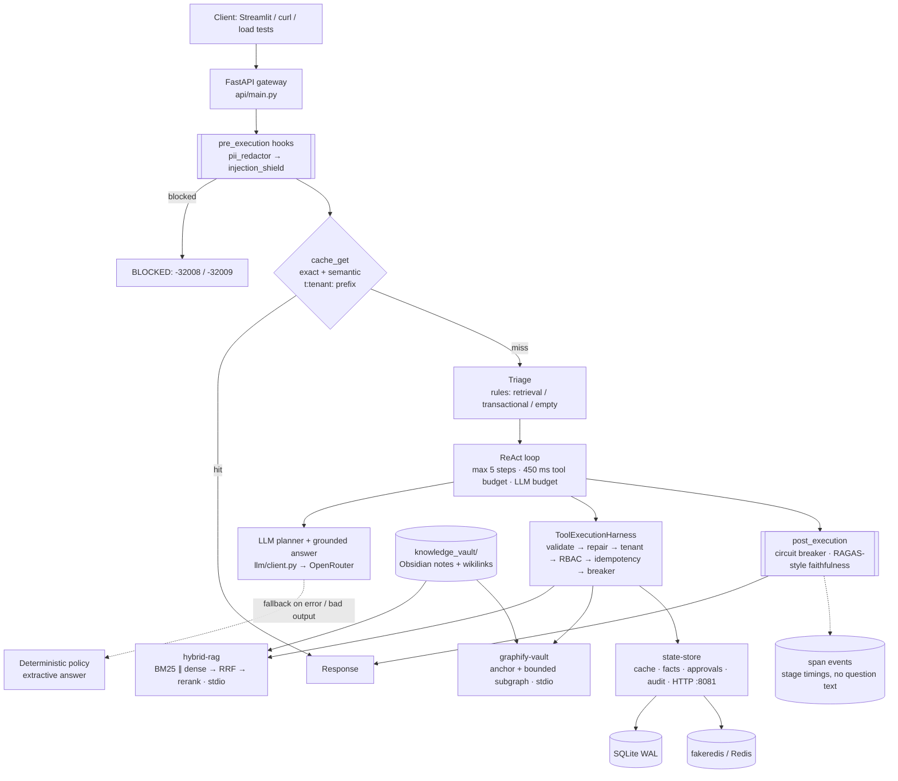
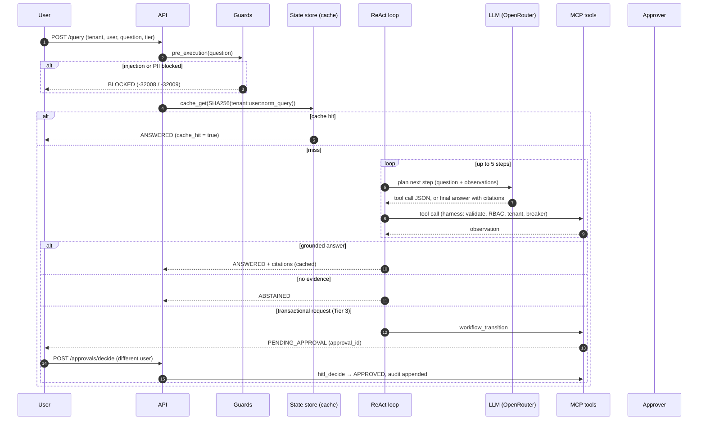

# The Unreliable Assistant: local PoC

A warehouse knowledge assistant built as a **bounded, auditable agent**. Every question goes through
ingress guardrails, a cache, triage, a bounded ReAct loop over MCP tool servers, and a human approval gate
for any state change. An LLM (OpenRouter) plans the steps and writes grounded answers, and a deterministic
fallback keeps answers correct when the model is unavailable.

This repository is a **local proof of concept** of the enterprise design in `design.md`. Backends that the
design runs in production (Postgres, Redis cluster, vLLM, ONNX rerankers, k6 at 50K virtual users) have
local stand-ins, and the evaluation results are labelled with their evidence class. See
[Status and limitations](#status-and-limitations).

---

## Contents

- [What it does](#what-it-does)
- [Architecture](#architecture)
- [Request flow](#request-flow)
- [Repository layout](#repository-layout)
- [Quick start](#quick-start)
- [Configuration](#configuration)
- [Running the stack](#running-the-stack)
- [Testing and evaluation](#testing-and-evaluation)
- [Design decisions and open ADRs](#design-decisions-and-open-adrs)
- [Status and limitations](#status-and-limitations)

---

## What it does

- Answers questions about SKUs, LOTs, safety protocols, storage conditions, returns and shifts, **only from
  the knowledge vault**. If the evidence is not there, it abstains.
- Blocks prompt injection and redacts PII **before** anything is cached, logged or sent to the model.
- Accepts state-changing requests (e.g. "release LOT-00044 from hold") **only as proposals**. They wait in
  `PENDING_APPROVAL` until a different user approves them. The approval is recorded in an append-only,
  hash-chained audit log.
- Keeps every tenant's data, cache keys and audit chain isolated.

## Architecture



**Components**

| Component | Where | Responsibility |
|---|---|---|
| API gateway | `api/main.py` | `/query`, `/approvals/decide`, `/audit/verify`, `/health` |
| Guardrails | `plugins/guards.py` | PII redaction and injection shield, both fail closed |
| Plugin manager | `plugins/` | pluggy hooks: `pre_execution`, `tool_dispatch`, `post_execution`, `span` |
| Cache and triage | `ingress/` | tenant-scoped exact and semantic cache; rule-based triage |
| ReAct loop | `harness/loop.py` | bounded state machine; never more than 5 steps |
| Tool harness | `harness/executor.py` | strict validation, one deterministic repair, tenant and RBAC checks, idempotency, circuit breaker |
| LLM policy | `harness/llm_policy.py` | planner and answer generation; citation and injection checks; deterministic fallback |
| LLM client | `llm/client.py` | OpenRouter (OpenAI-compatible), temperature 0, one jittered retry |
| Retrieval | `mcp_servers/rag_server.py`, `retrieval.py` | BM25 ∥ hashed-TF-IDF dense → RRF → lexical rerank, with abstention |
| Graph | `mcp_servers/graphify_server.py` | wikilink graph, anchor resolution, depth ≤ 2 subgraphs with token budget |
| State store | `mcp_servers/state_store.py` | tenant-scoped SQLite, fakeredis cache, HITL approvals, SHA-256 audit chain |
| Contracts | `contracts/` | Pydantic v2 models (`extra=forbid`, strict), error codes, repair rules R1–R4 |
| Workbench | `app.py` | Streamlit: Query, Retrieval, Graph, Approvals, Audit, KPI scorecard |
| Evaluation | `tests/eval/` | golden set, IR metrics, live LLM evaluation, 36-KPI scorecard |

## Request flow



**Guarantees the code enforces**
- Tenant comes from the session, never from the model. Every cache key and table row is tenant-scoped.
- The model can propose a tool call, but the harness checks the schema, the tier, the subagent binding and the
  idempotency key. A citation the model did not see is rejected.
- Tier-3 actions never execute without a different user's approval. The approver must differ from the requester.
- Repeated identical failing calls open a circuit breaker. Loops end at 5 steps, the tool budget, or the LLM budget.
- Retrieved text that matches the injection guard is hidden from the model.

## Repository layout

```
api/                 FastAPI gateway
app.py               Streamlit workbench (six tabs)
config.py            .env loader (no third-party dependency)
contracts/           Pydantic models, error codes, R1–R4 repair
harness/             tool executor, ReAct loop, LLM policy, subagent registry, transports
ingress/             triage and the request pipeline (cache, guards, loop, spans)
llm/                 OpenRouter client and LLM-as-judge scoring
mcp_servers/         rag, graphify and state-store MCP servers, retrieval and vault loaders
plugins/             pluggy hookspecs, guards, circuit breaker, RAGAS-style auditor, span collector
knowledge_vault/     Obsidian-style notes with YAML frontmatter and [[wikilinks]]
tests/               unit, integration, chaos, redteam, eval (golden set, live LLM, scorecard)
load_tests/          k6 script, JMeter plan, local async load runner
docs/                workflow diagram, ADR proposals and amendments, local run guide
results/             evidence JSON and scorecard (the state database is git-ignored)
design.md            locked architecture contract (do not edit silently)
CLAUDE.md            engineering rules for this repo
mcp_config.json      MCP server and plugin registration (proposed schema)
requirements.txt     pinned dependencies for pip
pyproject.toml, uv.lock   project metadata and lockfile for uv
```

## Quick start

Prerequisites: Python 3.11, and Graphviz if you want to re-render the diagram.

**With pip (no uv needed)**

```bash
python3.11 -m venv .venv
source .venv/bin/activate            # Windows: .venv\Scripts\activate
pip install -r requirements.txt
```

**With uv**

```bash
uv python install 3.11
uv sync
```

Then configure the LLM (optional, see below) and start the stack.

## Configuration

Settings come from environment variables. A `.env` file in the project root is loaded automatically, and
variables already set in your shell take precedence. The file is git-ignored.

```bash
cp .env.example .env     # then edit .env
```

| Variable | Default | Meaning |
|---|---|---|
| `LLM_BACKEND` | `api` if a key is set, else `mock` | `api` = OpenRouter, `mock` = deterministic and offline |
| `OPENROUTER_API_KEY` | (none) | your OpenRouter key; required for `api` |
| `OPENROUTER_MODEL` | `anthropic/claude-haiku-4.5` | any model your OpenRouter account can use |
| `LOOP_BUDGET_MS` | `450` | tool-step budget per question (design ADR-004) |
| `LLM_BUDGET_MS` | `3000` | LLM time budget per question (proposed, see `docs/ADR_AMENDMENT_001.md`) |
| `STATE_DB` | `state.sqlite3` | SQLite file for the state store |
| `CACHE_BACKEND` | `fake` | `fake` (fakeredis) or `redis` (uses `REDIS_URL`) |
| `OTEL_EXPORTER` | `console` | `console` only; `otlp` is not implemented |
| `ENV_FILE` | `.env` | path of an alternative env file |

## Running the stack

Start three processes, each in its own terminal, from the project root with the venv active:

```bash
# 1. state store (MCP over streamable HTTP, port 8081)
STATE_DB=results/state.sqlite3 python -m mcp_servers.state_store --port 8081

# 2. API gateway (port 8000); it starts the RAG and graph MCP servers over stdio itself
python -m uvicorn api.main:app --host 127.0.0.1 --port 8000 --workers 1

# 3. Streamlit workbench (port 8501)
python -m streamlit run app.py
```

Open <http://localhost:8501>. Try:

- **Query:** "What is the safety protocol for LOT-88392?" should return `ANSWERED` with citations.
- **Query with tier `TIER_3_MUTATE`:** "Release LOT-00044 from hold" returns `PENDING_APPROVAL`. Copy the approval id.
- **Approvals:** approve as a different user (`user_77`). Approving as the requester is refused.
- **Audit:** verify the chain for the tenant.

Smoke test from the command line:

```bash
curl -s localhost:8000/health
curl -s localhost:8000/query -H 'Content-Type: application/json' \
  -d '{"tenant_id":"tenant_7","user_id":"user_42","session_id":"sess_ab12cd34ef",
       "question":"What is the safety protocol for LOT-88392?","tier":"TIER_1_READ"}'
```

Use `LLM_BACKEND=mock` to run without any network access or key.

## Testing and evaluation

```bash
python -m ruff check . && python -m ruff format --check .
python -m mypy --strict contracts mcp_servers harness plugins ingress api llm config.py
python -m pytest tests -q -m "not live"          # offline: unit, integration, chaos, redteam, eval
python -m tests.eval.scorecard                    # regenerates results/scorecard.md
python -m load_tests.local_load --concurrency 20 --requests 400   # needs the API running
```

Live tests call the real model and are opt-in:

```bash
RUN_LIVE_EVAL=1 python -m pytest tests/eval -m live -q
```

**Evidence classes** (from `design.md` §1.5). Every result is labelled:
- `measured`: real measurement with a real backend. Used for the live OpenRouter runs.
- `indicative`: local mock backends or hand-labelled and synthetic sets.
- `design-only`: needs scaled load, real cost data or a streaming model. Not measured here.

Current scorecard: 32 of 36 KPIs measured, 21 passing, 4 design-only. The full table with targets, values and
notes is in `results/scorecard.md`. Read the notes before quoting a number. Several KPIs are proxies, and the
judge is the same model family as the generator.

## Design decisions and open ADRs

- **Contract:** `design.md` is locked. It was not edited.
- **Proposed deviations and additions** (need approval before the design text changes): `docs/ADR_PENDING.md`.
  Examples: lax UUID parsing on wire fields, `mcp` pinned below 2.0, tool arguments wrapped as `payload`, and
  planner and answer generation merged into one LLM call.
- **Latency amendment** (proposed): `docs/ADR_AMENDMENT_001.md`. The 450 ms budget covers tool steps only, and
  LLM time gets its own 3000 ms budget. Without this change, a remote LLM cannot answer inside the contract budget.
- **Triage is rule-based.** The design calls the triage agent `temp=0.0`, but its 25 ms budget cannot hold a
  remote call.

## Status and limitations

What is built and tested: the full path described above, the MCP servers over stdio and HTTP, the HITL approval
gate with its audit chain, tenant isolation, the Streamlit workbench, and the evaluation suite.

Known limitations:
- **Latency:** against a remote model, end-to-end p95 is about 3.5 s, well above the contract's 450 ms. This is
  why the amendment is proposed.
- **Faithfulness and relevancy** come from an LLM judge in the same model family as the generator, not from an
  independent judge or the RAGAS library.
- **Injection shield** is regex-based. It blocks the tested variants but not all homoglyph and leetspeak
  evasions. The red-team suite records these misses.
- **Retrieval** uses hashed TF-IDF and a lexical reranker, not BGE embeddings or a cross-encoder.
- **Not implemented:** Postgres state backend, OTLP export, streaming, the `DIRECT_ANSWER` route, the NLI
  claim check, and scaled k6 or JMeter runs. The `graphify` CLI build is also not included.
- **Scale:** the single-worker local load run is far below the 8,500 RPS design target.

## License

Not specified yet. Add a `LICENSE` file before publishing if the code should be reused.
