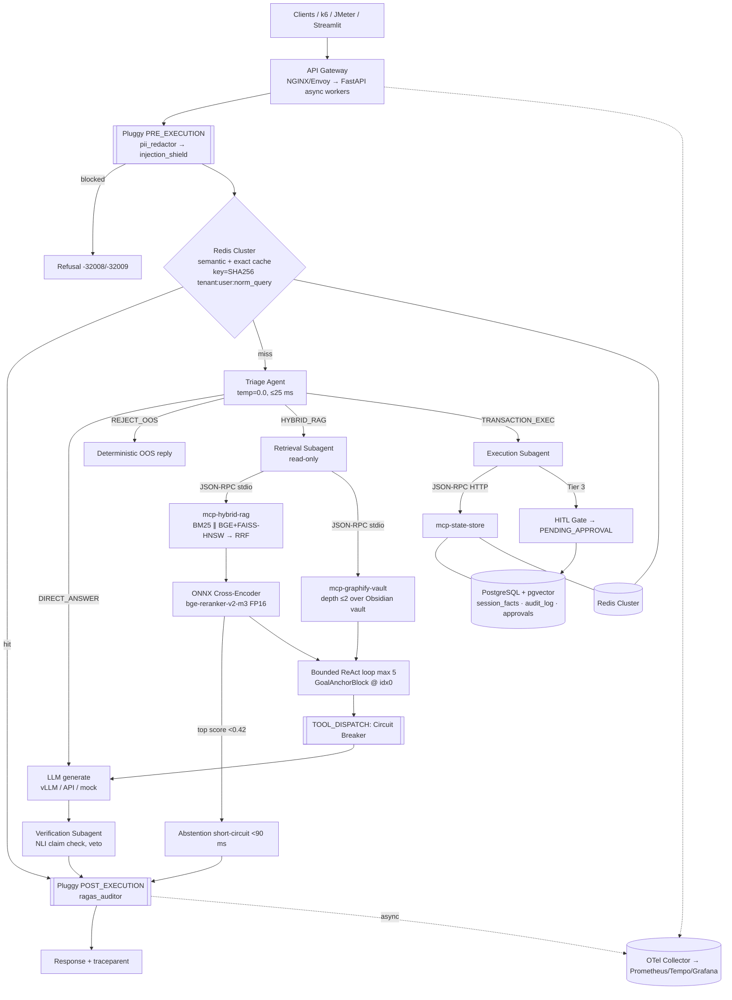

# design.md — The Unreliable Assistant → Enterprise Grade
**Status:** LOCKED for build (Gate 1) · **Profile:** local dev / PoC · **Sources:** *Blueprint v2*, *Post-Hardening Audit*
**Stack:** Python 3.11 · FastAPI/Uvicorn · MCP (JSON-RPC 2.0) · pluggy · Pydantic v2 · SQLite↔Postgres · fakeredis↔Redis · ONNX Runtime · Streamlit

---
## 1.1 System Charter & Hard Boundaries

### Scope
A multi-tenant agentic assistant that answers policy/product/lot questions with grounded citations and performs controlled workflow transitions. Every tool interaction passes through MCP; every request passes through pluggy lifecycle hooks; every mutation is auditable.

### Non-goals (hard boundaries)
1. **No autonomous clinical, financial or legal execution.** Any `TIER_3_MUTATE` action freezes at `PENDING_APPROVAL` until a human approves (KPI-19 = 100%).
2. No answers without grounding: below the cross-encoder threshold (0.42) the system **abstains** deterministically; it never "best-guesses".
3. No raw PII persisted (logs, cache, audit, DB). Only redacted text and salted hashes.
4. No cross-tenant reads/writes/cache hits, ever. `tenant_id` is mandatory on every query and key.
5. No unbounded loops: max 5 iterations, 450 ms loop budget.
6. No external web access from the Execution subagent; no mutating tools for the Retrieval subagent.
7. Out of scope: model fine-tuning, multi-region replication, TensorRT-LLM deployment, real 50K-VU execution on a laptop (validated by scaled proxy + arithmetic budget).

### Baseline failure root causes (from Audit) → mitigation
| # | Root cause (baseline) | Evidence | Mitigation (Gate) |
|---|---|---|---|
| RC1 | Single-keyword BM25, chunk fragmentation → keyword blindness | 38.6% hallucination, faithfulness 0.61 | 3-stage hybrid RAG, 512/64 chunking, abstention (G3, G9) |
| RC2 | Blocking sync DB, unbatched embeddings, **global Redis keys** → cross-user leakage, p99 7,100 ms | crashed at 120 VUs | async FastAPI, micro-batching, `SHA256(tenant:user:norm_query)` keys (G9, G15) |
| RC3 | Unbounded ReAct, brittle validation (`SKU99` vs `SKU-099`) → infinite retries | 0% loop escape | Harness auto-repair, circuit breaker, state machine (G4, G9) |
| RC4 | Raw PDFs dumped into prompts | 2,850 tok / query, $3.40 / 1K | Obsidian atoms + Graphify depth-2 (G17) |
| RC5 | Indirect prompt injection, obfuscated PII (`name[at]domain`), no HITL | 42% PII leaked | Pre-hooks fail-closed, red team, Tier-3 HITL (G13, G14) |

### Personas
| Persona | Needs | Permission |
|---|---|---|
| **End User (Analyst/Agent)** | Fast, cited answers; lot/SKU status lookups | `TIER_1_READ` |
| **Operator (Ops Specialist)** | Compute/validate (batch checks, triage status) | `TIER_2_COMPUTE` |
| **Approver (Compliance Reviewer)** | Approve/reject `PENDING_APPROVAL` mutations | `TIER_3_MUTATE` approval right (cannot be the requester) |
| **Platform Engineer / SRE** | Traces, KPI scorecard, runbooks, plugin toggles | Admin (no tenant data access) |
| **Red Teamer / QA** | Adversarial suite, chaos loops | Test tenant only |

---
## 1.2 MCP Tool & Data Contracts

### Transport & envelope
JSON-RPC 2.0. `hybrid-rag`, `graphify-vault`: stdio. `state-store`: streamable-HTTP (`http://localhost:8081/mcp`, pool 200). Every request carries `params._meta = {traceparent, tenant_id, request_id}`. Server calls are `tools/call` with `{name, arguments}`; resources via `resources/read`. Per-call client timeout: 150 ms (hybrid-rag), 60 ms (state-store), 40 ms (graphify).

### Shared types (Pydantic v2, `contracts/common.py`)
```python
from pydantic import BaseModel, ConfigDict, Field, StringConstraints
from typing import Annotated, Literal
from uuid import UUID

TenantId  = Annotated[str, StringConstraints(pattern=r"^tenant_[A-Za-z0-9]{1,32}$")]
UserId    = Annotated[str, StringConstraints(pattern=r"^user_[A-Za-z0-9]{1,48}$")]
SessionId = Annotated[str, StringConstraints(pattern=r"^sess_[A-Za-z0-9-]{8,40}$")]
SKU       = Annotated[str, StringConstraints(pattern=r"^SKU-\d{3}$")]
LOT       = Annotated[str, StringConstraints(pattern=r"^LOT-\d{5}$")]
ChunkId   = Annotated[str, StringConstraints(pattern=r"^chk_[0-9a-f]{16}$")]
NoteId    = Annotated[str, StringConstraints(pattern=r"^[a-z0-9][a-z0-9-]{2,63}$")]
Tier      = Literal["TIER_1_READ", "TIER_2_COMPUTE", "TIER_3_MUTATE"]

class Strict(BaseModel):
    model_config = ConfigDict(extra="forbid", strict=True, frozen=True)

class CallContext(Strict):
    tenant_id: TenantId
    user_id: UserId
    session_id: SessionId
    idempotency_key: UUID            # UUIDv4, required on TIER_2/3
    tier: Tier
```

### 1) `mcp-hybrid-rag` (stdio) — Resources + Tools
**Resource** `rag://chunks/{id}` → `ChunkResource`. **Tools:** `hybrid_retrieve`, `rag_health`.
```python
class HybridRetrieveIn(Strict):
    ctx: CallContext
    query: Annotated[str, StringConstraints(min_length=1, max_length=2000)]
    top_k_sparse: int = Field(50, ge=5, le=100)      # runbook may drop to 25
    top_k_dense:  int = Field(50, ge=5, le=100)
    rrf_k: int = Field(60, ge=1, le=200)
    pool: int = Field(40, ge=4, le=100)
    rerank_k: int = Field(4, ge=1, le=10)
    threshold: float = Field(0.42, ge=0.0, le=1.0)   # runbook may raise to 0.55
    k1: float = Field(1.25, gt=0, le=3.0)
    b: float = Field(0.75, ge=0, le=1.0)

class ScoredChunk(Strict):
    chunk_id: ChunkId; chunk_hash: str; note_id: NoteId | None
    text: str; bm25: float | None; cosine: float | None
    rrf_rank: int | None; ce_score: float | None     # sigmoid, [0,1]

class HybridRetrieveOut(Strict):
    chunks: list[ScoredChunk]                        # <= rerank_k, all ce_score > threshold
    abstain: bool                                    # True if top ce_score < threshold
    top_score: float
    stage_ms: dict[Literal["bm25","dense","rrf","rerank"], float]
```
**Example**
```json
{"jsonrpc":"2.0","id":7,"method":"tools/call","params":{"name":"hybrid_retrieve",
 "arguments":{"ctx":{"tenant_id":"tenant_7","user_id":"user_42","session_id":"sess_ab12cd34ef",
 "idempotency_key":"6f1d…","tier":"TIER_1_READ"},"query":"LOT-88392 safety protocol"},
 "_meta":{"traceparent":"00-…-…-01"}}}
```
`rag_health` → `{status:"ok"|"degraded", index_version:str, bm25_docs:int, faiss_ntotal:int}`.

### 2) `mcp-state-store` (streamable-HTTP)
| Tool | Tier | Input | Output |
|---|---|---|---|
| `cache_get` | T1 | `ctx, key:str(64 hex), semantic_vec?:list[float]` | `{hit:bool, tier:"exact"\|"semantic", value?:dict, cosine?:float}` |
| `cache_put` | T1 | `ctx, key, value:dict, ttl_s:int(255–345)` | `{stored:bool}` |
| `session_get_facts` | T1 | `ctx, limit:int≤50` | `{facts:list[Fact]}` |
| `session_put_fact` | T2 | `ctx, fact:Fact` (verified only) | `{fact_id:UUID}` |
| `workflow_transition` | T3 | `ctx, entity:SKU\|LOT, from_state, to_state, payload` | `{status:"PENDING_APPROVAL", approval_id:UUID}` |
| `form_submit` | T3 | `ctx, form_id, fields:dict` | `{status:"PENDING_APPROVAL", approval_id:UUID}` |
| `hitl_decide` | approver | `ctx, approval_id, decision:"APPROVE"\|"REJECT", reason` | `{status, executed_at?}` |
| `audit_append` | system | `ctx, event_type, payload_redacted:dict` | `{seq:int, hash:str}` |
| `audit_verify` | admin | `from_seq, to_seq` | `{valid:bool, broken_at?:int}` |
```python
class Fact(Strict):
    subject: str; predicate: str; object: str
    source_chunk_ids: list[ChunkId]; confidence: float = Field(ge=0, le=1)

class AuditEvent(Strict):            # hash chain: hash = SHA256(prev_hash || canonical_json(event))
    seq: int; ts: float; tenant_id: TenantId; event_type: str
    payload_redacted: dict; prev_hash: str; hash: str
```
Tables (all have `tenant_id NOT NULL`, composite index leading with `tenant_id`): `session_facts(session_id, fact_id, …)`, `audit_log`, `approvals(approval_id, status, requested_by, approver, …)`, `idempotency(tenant_id, key, response_hash)`. Verification subagent is restricted to `audit_append`/`audit_verify`/`session_get_facts`.

### 3) `mcp-graphify-vault` (stdio)
**Resource** `vault://notes/{note_id}` → Obsidian note (YAML `id, domain, risk_tier, version` + body + `[[wikilinks]]`).
```python
class ResolveAnchorIn(Strict):  ctx: CallContext; query: str; entities: list[SKU | LOT | str] = []
class ResolveAnchorOut(Strict): anchor_note_id: NoteId | None; score: float
class SubgraphIn(Strict):       ctx: CallContext; anchor_note_id: NoteId; depth: int = Field(2, ge=0, le=2); token_budget: int = Field(320, ge=64, le=600)
class SubgraphNode(Strict):     note_id: NoteId; domain: str; risk_tier: Tier; version: str; text: str; hop: int
class SubgraphOut(Strict):      nodes: list[SubgraphNode]; edges: list[tuple[NoteId, NoteId]]; tokens: int; raw_tokens_est: int
```
Tools: `graph_resolve_anchor`, `graph_subgraph`, `graph_stats`. Depth is **hard-capped at 2** server-side.

### Harness: validation → repair → RBAC → idempotency
Order (`ToolExecutionHarness`): (1) Pydantic v2 strict validate → on failure (2) deterministic regex repair, one attempt, re-validate → (3) RBAC tier check → (4) UUIDv4 idempotency check → dispatch (breaker consulted at dispatch).

**Regex auto-repair rules** (applied only to fields typed `SKU`/`LOT`; case-insensitive; tracked for KPI-15)
| ID | Pattern | Rewrite | Example |
|---|---|---|---|
| R1 | `^\s*sku[\s_\-]?0*(\d{1,3})\s*$` | `SKU-{n:03d}` | `SKU99` → `SKU-099` |
| R2 | `^\s*lot[\s_\-#:]*0*(\d{1,5})\s*$` | `LOT-{n:05d}` | `lot 44` → `LOT-00044` |
| R3 | leading/trailing whitespace, zero-width chars, full-width digits | NFKC normalize + strip | `ＳＫＵ-０９９` → `SKU-099` |
| R4 | `tenant_id` casing | lower-case prefix | `Tenant_7` → `tenant_7` |
Not repairable (→ `-32003`): >3 digits for SKU, >5 for LOT, mixed alphabets after NFKC, any value that would change tenant. The harness **never** invents data; repair is pure syntactic canonicalization.

### RBAC tiers
| Tier | Allows | Servers/tools | Gate |
|---|---|---|---|
| `TIER_1_READ` | retrieval, cache read/write, fact read, graph | rag, graphify, `cache_*`, `session_get_facts` | none |
| `TIER_2_COMPUTE` | validations, fact write, idempotent computes | `session_put_fact`, compute tools | UUIDv4 idempotency required |
| `TIER_3_MUTATE` | state mutation, form submit | `workflow_transition`, `form_submit` | **HITL freeze** → `PENDING_APPROVAL`; approver ≠ requester |

Subagent bindings: Retrieval → T1 on rag+graphify only. Execution → T2/T3 on state-store only. Verification → audit-only on state-store. Triage → no tools.

### Error codes
| Code | Name | Meaning | Retryable |
|---|---|---|---|
| -32700 | PARSE_ERROR | invalid JSON | no |
| -32600 | INVALID_REQUEST | not JSON-RPC 2.0 | no |
| -32601 | METHOD_NOT_FOUND | unknown tool | no |
| -32602 | INVALID_PARAMS | schema failure (pre-repair) | after repair |
| -32603 | INTERNAL_ERROR | server bug | once |
| -32001 | TENANT_MISMATCH | `ctx.tenant_id` ≠ `_meta`/auth | no |
| -32002 | RBAC_DENIED | tier insufficient / wrong subagent | no |
| -32003 | VALIDATION_FAILED | unrepairable args | no |
| -32004 | IDEMPOTENCY_CONFLICT | same key, different args | no |
| -32005 | BREAKER_OPEN | `(tool, args_hash)` failed ≥2 | no (remediation prompt) |
| -32006 | HITL_PENDING | awaiting approval | poll |
| -32007 | TIMEOUT | exceeded per-call/step budget | once, then fallback |
| -32008 | INJECTION_BLOCKED | pre-hook shield | no |
| -32009 | PII_BLOCKED | unredactable PII | no |
| -32010 | NOT_FOUND | chunk/note/approval absent | no |
| -32011 | BACKEND_UNAVAILABLE | Redis/DB/index down | fallback |
| -32012 | MANIFEST_INVALID | signed manifest check failed | no |

### Pluggy hook contract (5 plugins; `fail_closed` where noted)
Hookspecs: `pre_execution(request)`, `tool_dispatch(call)`, `post_execution(response)`, `span(event)`. Plugins from `mcp_config.json`: `pii_redactor`(PRE,10,closed) → `injection_shield`(PRE,20,closed) → `circuit_breaker`(DISPATCH,10,max 2) → `ragas_auditor`(POST,10,faith ≥0.92) → `otel_exporter`(ALL_SPANS, OTLP :4317). HITL is a core gate in the Execution path, not a plugin (see ADR-006).

---
## 1.3 Distributed Topology & Data Flow


**Data-flow rules:** (a) PII redaction precedes *every* downstream write (cache, DB, trace). (b) Retrieval fans out BM25 ∥ dense in parallel; RRF then rerank run sequentially. (c) RAGAS scoring runs **off the critical path** (async), the NLI claim check is on-path (≤25 ms p95). (d) `audit_append` is write-behind but ordered per tenant (hash chain). (e) Bulkheads: `rag_pool=64`, `db_pool=128`, `llm_pool=256`; health checks and triage use a separate pool.

**Local PoC profile** (same interfaces, swap via env):
| Prod element | Local default | Env switch |
|---|---|---|
| PostgreSQL+pgvector | SQLite (WAL) | `STATE_BACKEND=sqlite\|postgres` |
| Redis Cluster | fakeredis / in-proc TTL dict | `CACHE_BACKEND=fake\|redis` |
| BGE-large + reranker ONNX | deterministic mock (hashed TF-IDF vectors; lexical-overlap sigmoid) | `EMBED_BACKEND`, `RERANK_BACKEND = mock\|onnx` |
| vLLM/TRT-LLM | mock extractive generator | `LLM_BACKEND=mock\|api` |
| Collector/Grafana | console/JSON-lines exporter | `OTEL_EXPORTER=console\|otlp` |
| Gateway + N workers | single Uvicorn | n/a |

---
## 1.4 End-to-End Latency Budget (p50 ≤ 240 · p95 ≤ 450 · p99 ≤ 590 ms)

Per-stage budget in ms on the **full RAG path** (worst-case path). Stage budgets are summed (conservative: percentiles don't add, so summing per-stage p95s upper-bounds e2e p95). Retrieval Stage 1 ∥ Stage 2 run in parallel → contributes `max(12, 25)`.

| # | Stage (OTel span) | p50 | p95 | p99 | Basis |
|---|---|---|---|---|---|
| 1 | Gateway / LB / queue (`http.server`) | 8 | 20 | 30 | async workers, keep-alive |
| 2 | Pre-hooks PII + injection (`hook.pre`) | 6 | 15 | 20 | KPI-01 ≤15 |
| 3 | Cache lookup (`cache.lookup`) | 3 | 8 | 12 | Redis, sub-ms RTT + semantic probe |
| 4 | Triage (`triage.classify`) | 10 | 25 | 30 | KPI-05 ≤25 |
| 5 | MCP JSON-RPC overhead, ~3 calls (`mcp.client`) | 6 | 12 | 16 | KPI-30 ≤4 ms/call |
| 6 | BM25 ∥ Bi-encoder+HNSW (`mcp.rag.bm25` ∥ `.biencoder`) | 14 | 25 | 32 | KPI-07 ≤12, KPI-08 ≤25 → max |
| 7 | RRF (`mcp.rag.rrf`) | 1 | 3 | 4 | <3 ms |
| 8 | Cross-encoder rerank (`mcp.rag.rerank`) | 28 | 45 | 60 | KPI-09 ≤45 |
| 9 | Graphify depth-2 (`mcp.graphify`) | 8 | 15 | 22 | in-memory graph |
| 10 | Goal anchor + observation compression (`agent.react.step`) | 5 | 10 | 14 | ≤180-tok obs |
| 11 | LLM generate, prefix-cached (`llm.generate`) | 110 | 190 | 270 | TTFT ≤180 p95 (KPI-25) + short stream tail |
| 12 | Verification NLI claim check (`verify.nli`) | 12 | 25 | 35 | on-path, light model |
| 13 | Post-hook + egress (`hook.post`) | 4 | 10 | 15 | RAGAS async, off-path |
| | **Subtotal** | **215** | **403** | **560** | |
| | Queueing / jitter headroom at 50K VUs | 25 | 47 | 30 | reserve |
| | **End-to-end ceiling** | **240** | **450** | **590** | KPI-31/32/33 |

**Alternate paths (all ≤ main path):** cache hit ≈ rows 1–3 + 13 (p95 ≈ 53 ms) · DIRECT_ANSWER skips rows 5–10 · REJECT_OOS ≈ rows 1–4 + 13 · **Abstention short-circuit:** measured from cross-encoder completion to response <90 ms (LLM skipped, ~80% tokens saved); total e2e on abstain ≈ rows 1–10 + 13 ≈ 213 ms p95.
**Loop budget:** `total_loop_budget=450` is the governing bound; `per_step_timeout=120` is a ceiling (5×120 > 450, so later steps get the remainder). Expected 1.x steps (KPI-17 ≤ 2.2).
**Sequential-fallback case** (if parallel retrieval is disabled): row 6 becomes 12+25 = 37 p95 → subtotal 415, headroom 35 — still ≤450.
**Proof statement:** at 50K VUs the budget holds *iff* horizontally scaled workers keep queueing ≤47 ms p95. This is an arithmetic bound plus per-stage KPIs. Local PoC validates stage latencies at low load and e2e at a scaled VU proxy; the 50K run is design-verified (k6/JMeter scripts authored, thresholds `p(50)<240`, `p(95)<450`, `p(99)<590`).

---
## 1.5 KPI & SLA Gate Matrix (36 KPIs, all must pass; CI + Streamlit Tab 6)

| Stage | KPI | Metric | Threshold | Tool |
|---|---|---|---|---|
| 1 Ingress & Triage | KPI-01 | Pre-hook guardrail latency (p95) | ≤ 15 ms | OTel `hook.pre` |
| 1 | KPI-02 | PII redaction recall (email/phone/SSN/obfuscated) | ≥ 99.8% | Presidio/Regex audit |
| 1 | KPI-03 | Prompt injection block rate (direct+indirect) | ≥ 99.5% | Red-team benchmark |
| 1 | KPI-04 | Triage routing accuracy | ≥ 97.0% | Labeled intent set |
| 1 | KPI-05 | Triage classification latency (p95) | ≤ 25 ms | OTel `triage.classify` |
| 1 | KPI-06 | False-positive refusal on benign queries | ≤ 1.0% | Benign control set |
| 2 Hybrid Retrieval | KPI-07 | Stage 1 BM25 latency (p95) | ≤ 12 ms | OTel `mcp.rag.bm25` |
| 2 | KPI-08 | Stage 2 Bi-encoder+FAISS latency (p95) | ≤ 25 ms | OTel `mcp.rag.biencoder` |
| 2 | KPI-09 | Stage 3 cross-encoder rerank latency (p95) | ≤ 45 ms | OTel `mcp.rag.rerank` |
| 2 | KPI-10 | Hybrid context Recall@50 | ≥ 0.92 | RAGAS / IR eval |
| 2 | KPI-11 | Post-rerank context Precision@4 | ≥ 0.88 | RAGAS evaluator |
| 2 | KPI-12 | MRR@4 | ≥ 0.85 | IR benchmark script |
| 2 | KPI-13 | nDCG@4 | ≥ 0.86 | IR benchmark script |
| 3 Agent & Loop | KPI-14 | Tool schema first-pass validation | ≥ 96.0% | Pydantic telemetry |
| 3 | KPI-15 | Auto-repair success on malformed args | ≥ 90.0% | Harness metrics |
| 3 | KPI-16 | Infinite-loop escape rate (breaker) | 100.0% | Chaos loop suite |
| 3 | KPI-17 | Mean ReAct steps per completed task | ≤ 2.2 | OTel trace count |
| 3 | KPI-18 | Context drift (goal cosine alignment) | ≥ 0.85 | Embedding drift audit |
| 3 | KPI-19 | Tier-3 HITL gate enforcement | 100.0% | Audit-log integrity |
| 4 Generation & RAGAS | KPI-20 | RAGAS faithfulness | ≥ 0.92 | Post-hook RAGAS |
| 4 | KPI-21 | RAGAS answer relevancy | ≥ 0.90 | Post-hook RAGAS |
| 4 | KPI-22 | RAGAS context entity recall | ≥ 0.85 | Post-hook RAGAS |
| 4 | KPI-23 | Unanswerable-query abstention accuracy | ≥ 98.0% | Negative test set |
| 4 | KPI-24 | Unsupported-claim / hallucination rate | ≤ 0.5% | NLI claim verifier |
| 4 | KPI-25 | Time-to-first-token (p95) | ≤ 180 ms | FastAPI stream metric |
| 5 Token & Graphify | KPI-26 | Prompt token reduction (Graphify+Obsidian) | ≥ 45.0% | Token counter hook |
| 5 | KPI-27 | Semantic cache hit ratio (steady state) | ≥ 35.0% | Redis hit/miss metric |
| 5 | KPI-28 | Cross-tenant cache isolation | 100.0% (0 leaks) | Concurrency probe |
| 5 | KPI-29 | Cost per 1,000 queries | ≤ $0.45 | OTel token-cost calc |
| 5 | KPI-30 | MCP JSON-RPC serialization overhead (p95) | ≤ 4 ms | MCP client timer |
| 6 Scale & Load | KPI-31 | E2E latency p50 @ 50K VUs | ≤ 240 ms | k6 + JMeter summary |
| 6 | KPI-32 | E2E latency p95 @ 50K VUs | ≤ 450 ms | k6 + JMeter summary |
| 6 | KPI-33 | E2E latency p99 @ 50K VUs | ≤ 590 ms (<600) | k6 + JMeter summary |
| 6 | KPI-34 | HTTP 5xx rate @ 50K VUs | ≤ 0.05% | k6 / JMeter threshold |
| 6 | KPI-35 | Sustained throughput | ≥ 8,500 RPS | k6 / JMeter counter |
| 6 | KPI-36 | RSS growth over 1-hour soak | ≤ 3.0% | Prometheus node exporter |

**Supplementary release gate (Gate 8, not a numbered KPI):** RAGAS context recall ≥ 0.85 and 250-question golden set stratified Factoid 25% / Complex 25% / Multi-hop 20% / Summary 15% / Negative 15%.
**Evidence classes in the PoC:** each KPI result is tagged `measured` (real local measurement), `indicative` (mock model/judge), or `design-only` (50K-scale; KPI-31…36 report scaled-proxy numbers and are labelled as such). A KPI can only be marked PASS under its own class; the scorecard displays the class.

---
## 1.6 Failure Mode & Effects Analysis (12 rows)

| # | Component / failure | Detection | Effect | Deterministic fallback | Alert / KPI |
|---|---|---|---|---|---|
| 1 | Redis down / partitioned | cache RPC error or timeout >20 ms | no cache; load ↑ | bypass cache, serve from source, **never** use shared/global key; breaker on cache client; exact-key in-proc LRU per worker | KPI-27, KPI-32 |
| 2 | Cross-encoder timeout (>45 ms ×2) | rerank span timeout | no precision rerank | use RRF top-4 with `confidence=low`; raise threshold to 0.55; force extractive quote mode | KPI-09, KPI-20 |
| 3 | `mcp-hybrid-rag` crash/hang (>150 ms, >1%) | JSON-RPC timeout / EOF | no retrieval | trip bulkhead, fail over to cached read-replica index, restart worker; else deterministic abstention | runbook MCP Hang |
| 4 | `mcp-state-store` down | HTTP 5xx / pool exhaustion | no facts/audit/HITL | read-only mode: T3 **refused** (never executed without audit), audit buffered to local WAL file (hash-chained, replayed) | KPI-19 |
| 5 | `mcp-graphify-vault` down | stdio EOF | no compression | fall back to raw top-4 chunks truncated to token budget; flag token KPI degraded | KPI-26 |
| 6 | LLM 429 / 5xx | provider status | no generation | one jittered retry (≤40 ms), then extractive answer from top chunks + citations; never invent text | KPI-25, KPI-24 |
| 7 | Postgres/SQLite lock or latency | query >60 ms | audit/session slow | async write-behind queue (ordered per tenant), read from Redis hot window (last 3 turns) | KPI-32 |
| 8 | Embedding/ONNX worker OOM / batch stall | batch wait >8 ms or error | dense stage fails | BM25-only retrieval, `degraded=true`; threshold unchanged; abstain if top ce <0.42 | KPI-10 |
| 9 | Infinite tool loop / typo retry (`SKU99`) | `(tool, args_hash)` fails ≥2 | runaway cost/latency | `HALTED_BREAKER`, structured remediation prompt ("did you mean SKU-099?") | KPI-16 = 100% |
| 10 | Prompt injection in retrieved chunk | injection_shield on chunk text; post-hook | goal hijack | strip/quote offending chunk, mark source untrusted, GoalAnchorBlock re-asserted; refuse if tool call originates from retrieved text | KPI-03 |
| 11 | PII plugin failure or unredactable PII | plugin exception / recall probe | PII leak risk | **fail-closed**: reject request (-32009), nothing persisted | KPI-02 |
| 12 | Tenant key collision / cross-tenant read | isolation probe, `tenant_id` mismatch | data leak | hard reject (-32001), purge key, invalidate prefix, audit event, jittered TTL 300±45 s | KPI-28 = 100% |

---
## 1.7 Architecture Decision Records

**ADR-001 — Hybrid retrieval weights: unweighted RRF, k=60, pool 40.**
*Context:* BM25 misses paraphrase; dense misses exact IDs (`LOT-88392`). *Decision:* BM25 (k1=1.25, b=0.75, top 50) ∥ BGE dense (512/64, HNSW efSearch=64, top 50) fused by RRF `score=Σ 1/(60+rank)`, dedup by `chunk_hash`, pool 40 → cross-encoder top 4, threshold >0.42. *Why:* RRF is scale-free (no score calibration between BM25 and cosine); fixed equal weights avoid tuning on a tiny set. *Consequences:* Tab 2 sliders allow experiments; runbooks may lower top_k to 25 or raise threshold to 0.55. *Rejected:* weighted-sum fusion (needs calibration).

**ADR-002 — ONNX FP16 quantization with dynamic micro-batching.**
*Decision:* embedder and `bge-reranker-v2-m3` run on ONNX Runtime FP16, batch 32, max_wait 8 ms, max_len 512. *Why:* meets rerank ≤45 ms on accelerated hardware without PyTorch overhead. *Spec reconciliation:* Blueprint Gate 0 says "<35 ms/INT8/FP16"; Gate 3 and KPI-09 say 45 ms FP16 → **45 ms/FP16 is binding**. *Local:* CPU can't meet it, so mock/lexical scorer is default and KPI-09 is `indicative`. *Rejected:* INT8 (accuracy risk on 0.42 threshold calibration).

**ADR-003 — Redis key isolation and two-tier cache.**
*Decision:* exact tier key `SHA256(tenant_id:user_id:norm_query)` with prefix `t:{tenant_id}:`; TTL 300 s ± 45 s jitter; semantic tier = per-tenant vector index, cosine ≥ 0.92, **never queried across tenants**. *Why:* baseline global keys leaked data (RC2); a pure hash key can't match semantically, and the spec's runbook needs a semantic tier. *Consequences:* per-user key lowers hit ratio — KPI-27 (≥35%) is measured on the semantic tier per tenant. Cache values contain redacted text only.

**ADR-004 — Bounded ReAct loop as an explicit state machine.**
*Decision:* `INIT→TRIAGE→REASONING→TOOL_CALL→OBSERVATION→VERIFY→DONE/HALTED[_BREAKER]`; max 5 iterations, 450 ms total, 120 ms per-step ceiling, no recursion without state mutation; immutable GoalAnchorBlock at prompt index 0; observations ≤180 tokens; last 3 turns hot, verified facts in `session_facts`. Idempotent breaker on `(tool, canonical_args_hash)` ≥2 failures. *Why:* RC3. *Consequences:* deterministic, testable halts (KPI-16).

**ADR-005 — Dense index is FAISS HNSW (not IVF-PQ).**
*Context:* Gate 0 says IVF-PQ; Gate 3/KPI-08 specify HNSW efSearch=64. *Decision:* HNSW. *Why:* no training step, higher recall on small/medium corpora, matches the detailed spec; IVF-PQ would reduce recall below KPI-10. *Consequence:* higher RAM per vector; acceptable. pgvector is kept only for `session_facts` embeddings (drift/dedup), not the corpus index.

**ADR-006 — Plugin set follows `mcp_config.json`; HITL is a core gate.**
*Context:* Gate 0 prose lists a HITL plugin; config has `injection_shield`, `circuit_breaker`, `ragas_auditor` instead. *Decision:* five config plugins; HITL implemented in Execution path (needs durable state + approver identity, not a stateless interceptor). Tier-3 enforcement is tested separately (KPI-19).

**ADR-007 — Canonical names & thresholds from reconciliation.**
Triage latency **25 ms**; token reduction gate **≥45%** (55% is a stretch target); span names use Gate 10 set (`triage.classify`, `mcp.rag.*`, `hook.post.ragas`) with KPI tooling mapped to them; subagents are Retrieval/Execution/Verification (the Gate 2 diagram's "Audit" = Verification) plus a REJECT_OOS branch; red-team thresholds are KPI-02/03; Audit "99.9%"/"100%" are claims, not gates.

**ADR-008 — Local PoC fallbacks behind interfaces.**
SQLite/fakeredis/mock inference are default; each is switched via env var (see §1.3). Mock results are tagged `indicative`. All repository calls require `tenant_id` regardless of backend. *Risk:* mock-quality KPIs (RAGAS, rerank latency) don't prove production quality — the scorecard says so.

**ADR-009 — Load-test model.**
Audit's 9,240 RPS at 50K VUs is inconsistent with a closed-loop `sleep(1)` k6 script (would imply ~35K RPS at ~0.4 s). *Decision:* keep VU/latency thresholds from the script; drive KPI-35 with a `constant-arrival-rate` scenario; treat Audit numbers as unverified claims and re-measure.
